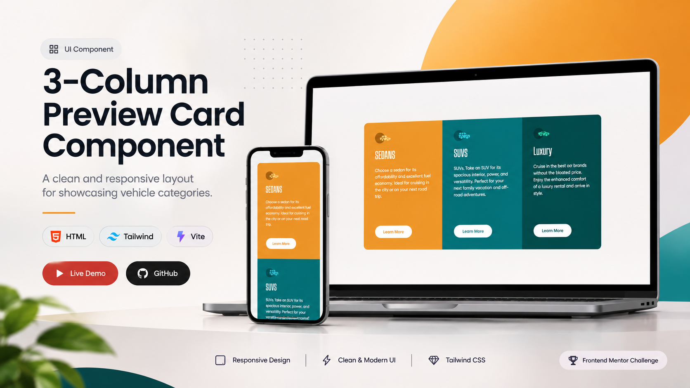

# 3-Column Preview Card Component

Preview image



---

## Project Links & Badges

[](https://01-newbie-3-column-preview-card-compo.netlify.app/)  
[](https://github.com/arwinux/frontend-journey/tree/main/01-newbie/three-column-preview-card-component)  
[](#)  
[](https://opensource.org/licenses/MIT)  
[](https://github.com/arwinux)  
[](https://www.netlify.com)  
[](#)

---

## Overview

A responsive three-column preview card built for a Frontend Mentor challenge. Presents Sedans, SUVs, and Luxury vehicle categories with hoverable Learn More buttons. Styled with Tailwind CSS utility classes and bundled with Vite.

### The challenge

- View the optimal layout depending on the device's screen size
- See hover states on the interactive Learn More buttons
- Present three categories: Sedans, SUVs, and Luxury
- Show each card with an icon, heading, and short description
- Match the provided mobile and desktop designs

### Links

- **Solution URL:** [GitHub Repository](https://github.com/arwinux/frontend-journey/tree/main/01-newbie/3-column-preview-card-component)
- **Live Site URL:** [Live demo](https://01-newbie-3-column-preview-card-compo.netlify.app/)
- **Challenge URL:** [3-column preview card component](https://www.frontendmentor.io/challenges/3column-preview-card-component-pH92eAR2-)

---

## My process

### Built with

- Semantic HTML5
- Tailwind CSS v4 (utility-first styling with `@theme` design tokens)
- Vite (dev server and build tool)
- Google Fonts: Lexend Deca and Big Shoulders
- Vanilla JavaScript (author signature badge)

### Project Structure

```
3-column-preview-card-component/
├── design/
│   ├── active-states.jpg
│   ├── desktop-design.jpg
│   └── mobile-design.jpg
├── src/
│   ├── assets/
│   │   └── images/
│   ├── css/
│   │   └── style.css
│   └── js/
│       └── programmer-badge.js
├── index.html
├── package.json
├── preview.jpg
├── README.md
├── style-guide.md
└── vite.config.ts
```

### Continued development

- Wire up `programmer-badge.js` in `index.html` so the author badge interaction works on touch devices
- Replace the Learn More buttons with links and correct the icon alt text for each vehicle
- Add an `<h1>` and a clear heading hierarchy for better document structure
- Extract repeated Tailwind class strings into reusable components or utilities
- Add a theme variant (such as dark mode) using the existing Tailwind color tokens

### Useful resources

- [Tailwind CSS Documentation](https://tailwindcss.com/docs) - Reference for utility classes and the `@theme` directive.
- [Vite Documentation](https://vite.dev/) - Guide for the dev server and build setup.
- [MDN: CSS :hover](https://developer.mozilla.org/en-US/docs/Web/CSS/:hover) - Reference for the button hover states.
- [Google Fonts: Lexend Deca](https://fonts.google.com/specimen/Lexend+Deca) - Body typeface used by the project.
- [Google Fonts: Big Shoulders](https://fonts.google.com/specimen/Big+Shoulders) - Display typeface used for headings.

---

## Author

- Frontend Mentor - https://www.frontendmentor.io/profile/arwinux
- GitHub - https://github.com/arwinux

---

## Acknowledgments

Thanks to Frontend Mentor for the challenge and to the open-source community for the tools and resources that made this project possible.
