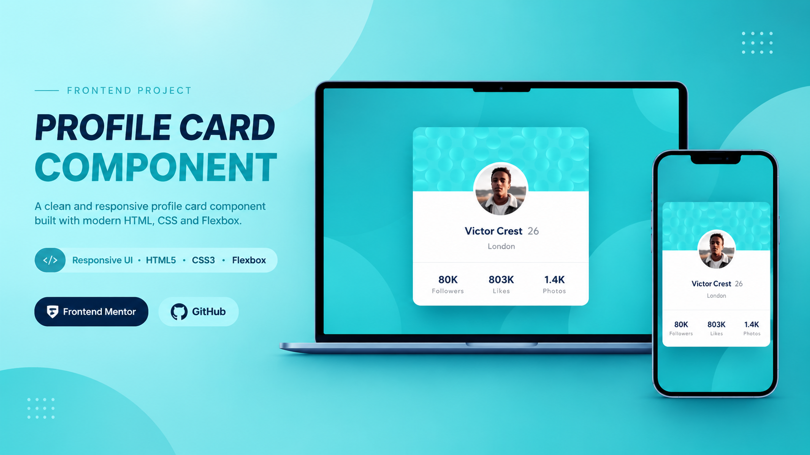

# Profile Card Component

Preview image



---

## Project Links & Badges

[](https://arwinux.github.io/frontend-journey/01-newbie/profile-card-component/)  
[](https://github.com/arwinux/frontend-journey/tree/main/01-newbie/profile-card-component)  
[](#)  
[](https://opensource.org/licenses/MIT)  
[](https://github.com/arwinux)  
[](#)  
[](#)

---

## Overview

A responsive profile card component built for a Frontend Mentor challenge. Shows a user's name, age, location, and social statistics inside a centered, rounded card over decorative background patterns. Built with semantic HTML and CSS using custom properties, Flexbox, and the Kumbh Sans typeface.

### The challenge

- Build the card layout to match the provided mobile and desktop designs
- Display the user's name, age, and location
- Show social statistics for Followers, Likes, and Photos
- Render the decorative top and bottom background patterns behind the card
- Keep the layout centered and responsive across screen sizes

### Links

- **Solution URL:** [GitHub Repository](https://github.com/arwinux/frontend-journey/tree/main/01-newbie/profile-card-component)
- **Live Site URL:** [Live demo](https://arwinux.github.io/frontend-journey/01-newbie/profile-card-component/)

---

## My process

### Built with

- Semantic HTML5
- CSS Custom Properties
- Flexbox
- BEM naming convention
- Self-hosted Kumbh Sans variable font

### Project Structure

```
profile-card-component/
├── assets/
│   ├── fonts/
│   │   └── KumbhSans/
│   └── images/
├── design/
├── src/
│   └── css/
│       ├── main.css
│       ├── reset.css
│       ├── typography.css
│       └── variable.css
├── index.html
├── preview.jpg
├── README.md
└── style-guide.md
```

### Continued development

- Improve the document outline with a proper heading hierarchy for the name and stats
- Enhance accessibility with better alt text and visible focus states
- Replace duplicated spacing declarations (like the stats padding) with shared tokens
- Optimize the decorative background images for faster loading
- Add explicit breakpoints for finer control at large screen sizes

### Useful resources

- [MDN: CSS Custom Properties](https://developer.mozilla.org/en-US/docs/Web/CSS/Using_CSS_custom_properties) - Reference for managing colors and design tokens.
- [CSS-Tricks: A Complete Guide to Flexbox](https://css-tricks.com/snippets/css/a-guide-to-flexbox/) - Used to center and align the card content.
- [MDN: @font-face](https://developer.mozilla.org/en-US/docs/Web/CSS/@font-face) - Used to self-host the Kumbh Sans variable font.
- [Google Fonts: Kumbh Sans](https://fonts.google.com/specimen/Kumbh+Sans) - The typeface used by the project.
- [Frontend Mentor](https://www.frontendmentor.io/) - Platform for frontend coding challenges.

---

## Author

- Frontend Mentor - https://www.frontendmentor.io/profile/arwinux
- GitHub - https://github.com/arwinux

---

## Acknowledgments

Thanks to Frontend Mentor for the challenge and to the open-source community for the tools and resources that made this project possible.
